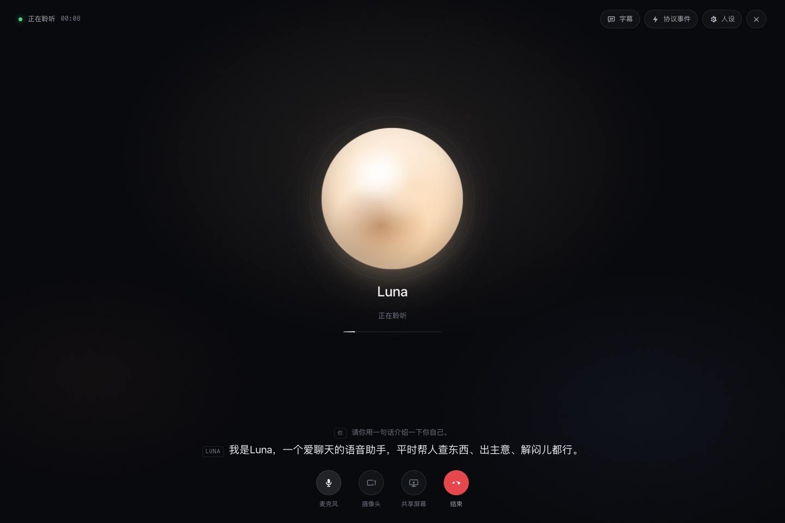
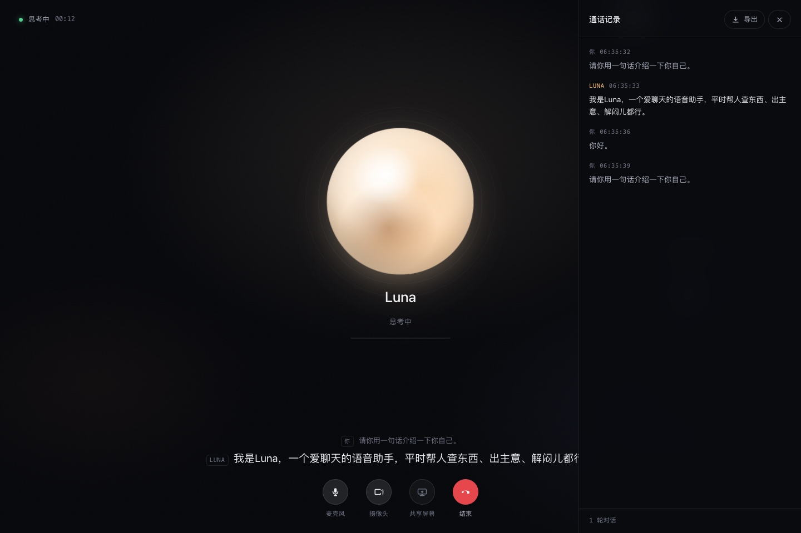
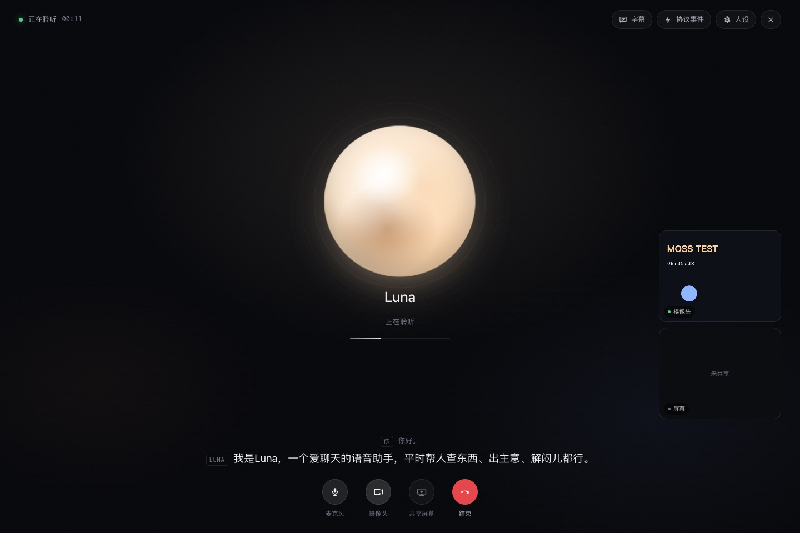
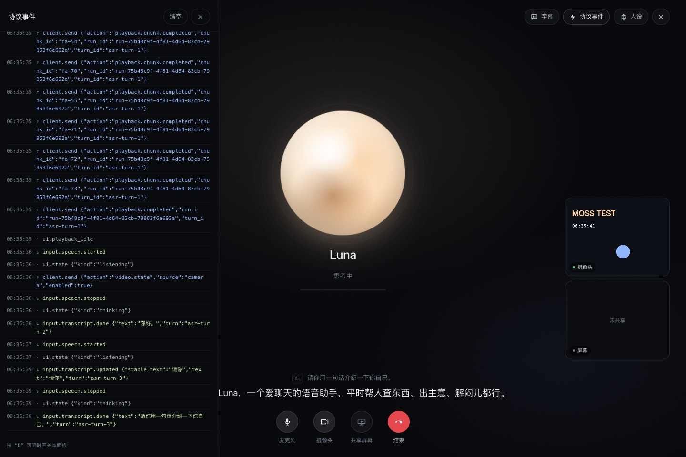
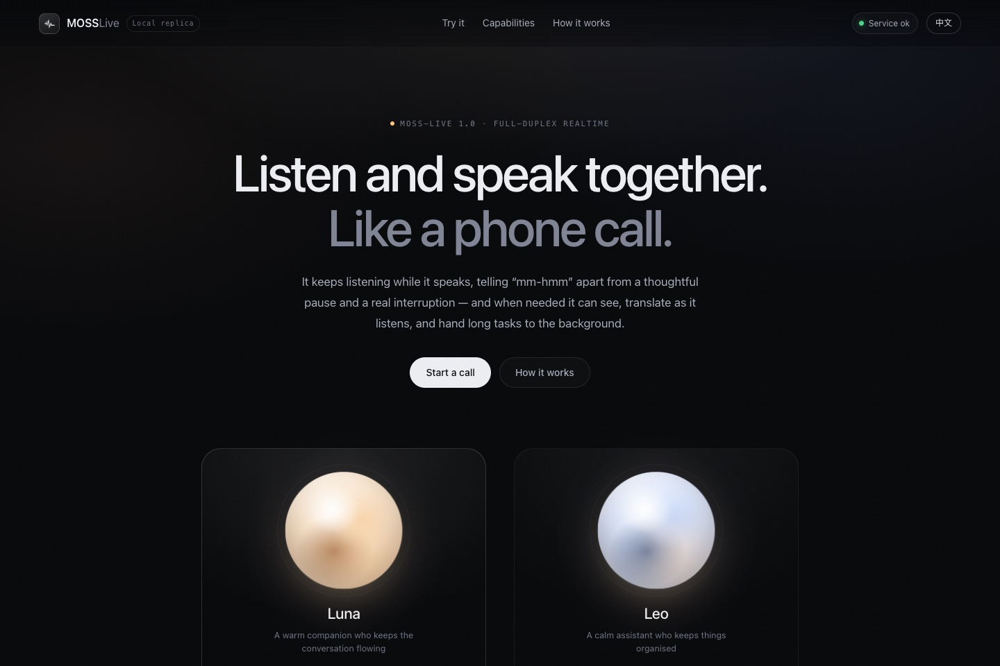

# MOSS Live · 全双工实时语音 Demo（本地复刻版）

基于 [MOSS API](https://platform.moss.cn/docs/getting-started/quickstart/) 的 `moss-live-1.0`
实时交互模型，复刻 [MOSS Live 官方 Demo](https://www.moss.cn/en/products/moss-live) 的核心体验：
像打电话一样边说边听、可被打断、实时字幕、摄像头与屏幕共享理解。

浏览器只连接本机的 FastAPI 中继，API Key 全程留在服务端。


| 通话界面                             | 字幕记录                                       |
| ------------------------------------ | ---------------------------------------------- |
|      |           |

---

## 1. 已实现的功能

| 官方 Demo 的能力                       | 本项目对应实现                                               | 状态 |
| -------------------------------------- | ------------------------------------------------------------ | ---- |
| 双角色（Luna / Leo）、点击电话开始通话 | 角色舞台 + 光球 + 通话浮层，人设可编辑                       | ✅   |
| 接通后主动打招呼                       | 预生成问候音频，接通 0.4 s 后本地播放，用户一开口立即淡出    | ✅   |
| 全双工：边说边听                       | 上行音频持续发送，不等待回答结束                             | ✅   |
| 语义打断（barge-in）                   | 收到 `response.audio.stop` 立即停播并回执 `playback.stopped` | ✅   |
| 实时字幕                               | 用户与助手双向流式字幕 + 可展开的通话记录                    | ✅   |
| 摄像头 / 屏幕共享理解                  | `getUserMedia` / `getDisplayMedia` → JPEG 1 FPS 上行         | ✅   |
| 关注画面切换（camera / screen / auto） | `video.stream_focus` 控制                                    | ✅   |
| 同声传译 / 视觉助手等场景              | 4 个场景预设，叠加到 `instructions`                          | ✅   |
| 语音回执与播放进度感知                 | 每个音频块播放完成回执 + 本轮 `playback.completed`           | ✅   |
| 中英双语                               | 全站 i18n，切语言即重取配置                                  | ✅   |
| 协议可观测                             | 通话内「协议事件」面板，实时显示上下行事件                   | ✅   |
| 通话记录导出                           | 导出 Markdown（含时间戳、被打断标记）                        | ✅   |

额外做了：音量驱动的光球律动、静音/摄像头/屏幕快捷键（M / C / S / T / D）、
Esc 双击结束通话、移动端布局、服务端令牌桶式限额、运行指标 `/api/health`。

> 音色说明：`moss-live-1.0` 的输出音色由模型固定，`session.update` 不接受
> `voice_id`（传了会被上游以 `invalid_public_request` 断开）。本项目用「人设 + 语气」
> 区分 Luna 与 Leo，而不是音色。详见
> [docs/DEVELOPMENT.md §3 上游协议事实](docs/DEVELOPMENT.md#3-上游协议事实实测)。

> 开场问候：MOSS-Live 是「用户先开口」的模型 —— 会话配置完成后即使一直送静音，
> 它也不会主动说话（实测 8 s 内零下行音频），所以官网只能用预生成音频的方式让人先开口。
> 本项目用 `scripts/gen_greeting.py` 让模型**用后续回答的那个声音**说一句自我介绍，
> 把这轮音频存成静态 WAV，接通后 0.4 s 播放。这样问候和正片是同一个音色，
> 不会像外接 TTS 那样「打招呼一个声音、回答另一个声音」。
> 仓库里已带 Luna / Leo × 中英共 4 条；改了人设想重录时见 [§4.3](#43-重新生成开场问候)。

### 1.1 更多界面截图

| 摄像头理解                                                                        | 协议事件面板                                                                         |
| --------------------------------------------------------------------------------- | ------------------------------------------------------------------------------------ |
|                                               |                                                 |
| 右下浮层是上行给模型的本地画面（1 FPS JPEG）；没开屏幕共享时显示「未共享」         | 通话内实时显示上下行协议事件，按 `\` 随时开关                                        |

| 英文界面                                                        | 通话结束                                            |
| --------------------------------------------------------------- | --------------------------------------------------- |
|                              |           |
| 全站 i18n，右上角一键切换语言，切完即重取配置                   | 挂断后回到落地页，可重新呼叫                        |

---

## 2. 架构

```
┌─────────────────────────────────────┐                                     ┌───────────────────────┐
│  浏览器                             │  ws://127.0.0.1:8000/ws/realtime    │  FastAPI 中继         │
│  · AudioWorklet 采集 48k → 16k PCM  │  ──────────►                        │  · 注入 Bearer        │
│  · WebAudio 48k 分块播放 + 回执     │  ──────────►                        │  · 指令白名单校验     │
│  · 摄像头 / 屏幕 → JPEG             │  ──────────►                        │  · session 字段清洗   │
│  · 字幕 / 记录 / 调试面板           │  ◄──────────                        │  · 帧大小 / 时长上限  │
└─────────────────────────────────────┘                                     └───────────────────────┘
                                                                                        │ wss
                                                                                        ▼
                                                                             api.mosi.cn/v1/realtime
                                                                                  moss-live-1.0
```

为什么要中继：

1. 浏览器原生 WebSocket **无法**在握手时设置 `Authorization` 头；
2. API Key 不能出现在前端代码或网络请求里；
3. 上游对 `session.update` 的字段校验极严（多一个键就断开），需要在服务端清洗。

上游协议的全部实测结论（连接参数、媒体封装、下行节奏、打断回执等）集中在
[docs/DEVELOPMENT.md §3](docs/DEVELOPMENT.md#3-上游协议事实实测)，改协议相关代码前先读那一节。

---

## 3. 环境要求

| 项目         | 要求                                                                                    |
| ------------ | --------------------------------------------------------------------------------------- |
| Python       | 3.10+（本机验证：3.13.12）                                                              |
| 浏览器       | Chrome / Edge 100+、Safari 16+（需支持 AudioWorklet）                                   |
| 网络         | 可访问 `api.mosi.cn`（WSS）                                                             |
| MOSS API Key | 在 [API Key 管理平台](https://platform.moss.cn/app/api-keys/) 创建，需有 MOSS-Live 权限 |
| 系统         | macOS / Linux 已验证；Windows 需 WSL2 或 Docker（未做原生验证）                         |

麦克风/摄像头只在 **HTTPS 或 localhost** 下可用；局域网访问请按
[deploy/nginx.conf.example](deploy/nginx.conf.example) 配置 TLS。

---

## 4. 快速开始（本机）

> **先决定安装路径，再动手。** 下面命令里的 `/Users/xxx/moss-live` 是占位符，
> 请替换成你自己的真实目录（例如 `/Users/你的用户名/python/moss-live`）。
> 一旦装过 `install_macos_launchd.sh` 或往 `~/.zshrc` 里加过自启钩子，绝对路径就被固化了：
> 之后重命名或移动目录，会表现为“8000 端口杀不掉、进程反复复活”。
> 要移动目录，请先卸载自启（`./scripts/install_macos_launchd.sh uninstall`），移动后重新安装。
> 路径里不要带空格和中文。详见 [docs/DEPLOY.md](docs/DEPLOY.md)。

新手按下面三步走（推荐）：

**第 1 步：拿到代码**

```bash
git clone https://github.com/gsyzycww/moss-live.git
cd moss-live
```

没装 git 就到仓库页点 `Code → Download ZIP`，解压后 `cd moss-live`。

**第 2 步：准备 API Key**

到 [API Key 管理平台](https://platform.moss.cn/app/api-keys/) 创建一个，确认账号有
MOSS-Live 权限。密钥只在服务端使用，不会进浏览器。计费按连接在线时长。

**第 3 步：安装并启动**

```bash
cd /Users/xxx/moss-live # 换成你刚才 clone 下来的路径
./scripts/install.sh          # 建 venv、装依赖、生成 .env、自检
./scripts/install.sh --start  # 装完直接前台启动
```

> 第 3 步会生成 `.env` 但**不会替你填密钥**——装完编辑 `.env` 把
> `MOSS_API_KEY=` 后面补上真实值，再启动。不填也能打开页面，只是右上角会显示
> 「缺少密钥」，点电话会连不上。

> `install.sh` 只准备运行环境（venv / 依赖 / `.env` / 自检），**不会注册开机自启**，
> 也不会改动你的 shell 配置。想开机自启要显式执行
> `./scripts/install_macos_launchd.sh install`，见 [§4.2](#42-让它常驻)。

手工版（效果相同，便于理解每一步）：

```bash
cd /Users/xxx/moss-live # 跳转到moss-live目录

# 1) 创建虚拟环境并安装依赖（也可以直接跑 scripts/run.sh，它会自动完成）
python3 -m venv .venv
source .venv/bin/activate
pip install -r requirements.txt

# 2) 配置密钥
cp .env.example .env
#   编辑 .env，填入 MOSS_API_KEY=sk-xxxx

# 3) 启动
uvicorn app.main:app --host 127.0.0.1 --port 8000
#   或：./scripts/run.sh
```

打开 <http://127.0.0.1:8000> → 点角色下方的电话按钮 → 允许麦克风 → 说话。
右上角状态灯应为「服务正常」；显示「缺少密钥」说明 `.env` 里的 Key 没填或没重启。

**到这里就能用了，不需要再配置任何东西。** 下面三节都是可选内容，遇到对应需求再看：

| 你想做的事                               | 去哪节                                  |
| ---------------------------------------- | --------------------------------------- |
| 搬到另一台机器 / 用手机访问              | [§4.1](#41-换一台设备安装)              |
| 关掉终端也继续跑、开机自动起来           | [§4.2](#42-让它常驻)                    |
| 改过角色人设，想重录开场问候             | [§4.3](#43-重新生成开场问候)            |

### 4.1 换一台设备安装

项目没有硬编码绝对路径，整个目录可以原样搬走；除 `.venv` 外约 2 MB（其中约 1.2 MB 是
文档截图、1.1 MB 是预生成的开场问候音频——4 个 wav 不需要可以删，前端会自动跳过）。

前提：Python 3.10+（本项目在 3.13 验证）。不需要 Node，不需要 ffmpeg。
macOS / Linux 已验证；Windows 请用 WSL2 或 Docker。

```bash
# 旧机器：在项目的父目录打包（下面假设目录名就叫 moss-live）
cd /Users/xxx
tar --exclude='moss-live/.venv' \
    --exclude='moss-live/logs' \
    --exclude='moss-live/artifacts' \
    --exclude='moss-live/.git' \
    --exclude='__pycache__' \
    -czf moss-live.tar.gz moss-live          # 约 2 MB

# 新机器：解包并安装（install.sh 幂等，可反复执行，从不覆盖已有 .env）
tar -xzf moss-live.tar.gz && cd moss-live
./scripts/install.sh --start
```

包里有 `.env`（含 API Key），传输请走 AirDrop / `scp` / U 盘；换人使用就加
`--exclude='moss-live/.env'`，到新机器 `install.sh` 会生成空 `.env`，再手动填 key。

接着按需要选：

- 想关掉终端后继续跑 → [§4.2](#42-让它常驻)
- 想从手机 / 另一台电脑访问 —— 改监听地址、上 HTTPS、设访问口令，
  三件事缺一不可 → [docs/DEPLOY.md §12.4](docs/DEPLOY.md#124-从别的设备访问手机另一台电脑)
- 装好之后升级代码 → [docs/DEPLOY.md §12.5](docs/DEPLOY.md#125-更新已有安装)

完整迁移细节（先决条件、`.env` 取舍、证书选型）见
[docs/DEPLOY.md 第 12 节](docs/DEPLOY.md#12-换一台设备安装迁移)。

### 4.2 让它常驻

`./scripts/run.sh` 是前台运行，`Ctrl+C` 或关掉终端就停。想让它常驻，按平台选一种：

| 平台                     | 做法                                                              |
| ------------------------ | ----------------------------------------------------------------- |
| macOS                    | `./scripts/install_macos_launchd.sh install`                      |
| macOS（无 launchd 权限） | `./scripts/autostart.sh` + 把钩子加进 `~/.zshrc`（见下方方式二）   |
| Linux                    | `deploy/moss-live.service` → `systemctl enable --now moss-live`   |
| 任意                     | `docker compose up -d --build`                                    |

macOS 的两种方式展开如下，**装一种就够**：

**方式一：LaunchAgent（推荐）** —— 登录即启动、崩溃由系统拉起，完全不用开终端：

```bash
./scripts/install_macos_launchd.sh install     # 注册 LaunchAgent（只需一次）
./scripts/install_macos_launchd.sh status      # 查看运行状态
./scripts/install_macos_launchd.sh restart     # 重启
./scripts/install_macos_launchd.sh uninstall   # 卸载
tail -f logs/moss-live.log                     # 看日志
```

**方式二：终端钩子** —— 适合 `launchctl bootstrap` 被系统拒绝（`5: Input/output error`）
的受限环境。`scripts/autostart.sh` 是幂等的，已在运行则立即返回；在 `~/.zshrc` 末尾
追加下面这个标记块，打开任意终端时顺手拉起：

```zsh
# >>> MOSS Live autostart >>>
if [ -x /Users/xxx/moss-live/scripts/autostart.sh ]; then
  /Users/xxx/moss-live/scripts/autostart.sh --quiet >/dev/null 2>&1 &!
fi
# <<< MOSS Live autostart <<<
```

```bash
./scripts/autostart.sh            # 确保在跑（会等就绪并打印 pid）
./scripts/autostart.sh --status   # 只看状态：0=运行中 1=未运行
./scripts/autostart.sh --stop     # 停止（下次开终端会再被拉起）
```

> ⚠️ 方式二的钩子里是**绝对路径**，必须替换成你的真实目录；之后改名、移动项目或换用户名
> 都要同步修改，否则钩子会静默失败（不报错也不启动）。两种方式可以共存（`autostart.sh`
> 幂等，检测到在跑就直接返回），但只装一种就够。细节与踩坑记录见
> [docs/DEPLOY.md §11](docs/DEPLOY.md#11-自启方案与常见坑)。

### 4.3 重新生成开场问候

改了人设名称或语气之后，问候音频要重录，否则接通的自我介绍会和后面的人格不一致。

```bash
.venv/bin/python scripts/gen_greeting.py              # 全部角色 × 中英，已存在的跳过
.venv/bin/python scripts/gen_greeting.py --force      # 全部重录
.venv/bin/python scripts/gen_greeting.py --persona luna --lang zh
```

脚本做的事：先用 `moss-tts-1.5-flash` 合成一句「你好呀」当作模拟用户上行，让
`moss-live-1.0` 回一句自我介绍，再把这轮下行音频裁掉首尾静音、存到
`app/static/audio/greeting-<角色>-<语言>.wav`。每条大约消耗几秒会话时长。

生成的音频会被浏览器缓存 1 小时（`/static/audio/` 单独设了 `max-age=3600`），
重录后如果没听到变化，硬刷新一次页面。

关掉这个功能：`.env` 里设 `APP_GREETING_ENABLED=false`。前端拿不到音频文件时也会
静默跳过，不影响通话。

---

## 5. 配置项（`.env`）

| 变量                    | 默认值                          | 说明                                              |
| ----------------------- | ------------------------------- | ------------------------------------------------- |
| `MOSS_API_KEY`          | 空                              | 必填。只保存在服务端，`/api/health` 只回显末 4 位 |
| `MOSS_WS_ENDPOINT`      | `wss://api.mosi.cn/v1/realtime` | 上游实时接口                                      |
| `MOSS_REST_ENDPOINT`    | `https://api.mosi.cn`           | 上游 REST 地址，`gen_greeting.py` 合成问候时用    |
| `MOSS_MODEL`            | `moss-live-1.0`                 | 模型 ID                                           |
| `MOSS_TTS_MODEL`        | `moss-tts-1.5-flash`            | 重录开场问候时用来合成「模拟用户语音」的 TTS 模型 |
| `APP_HOST` / `APP_PORT` | `127.0.0.1` / `8000`            | 监听地址                                          |
| `APP_ACCESS_CODE`       | 空                              | 非空时浏览器需带 `?code=xxx`，用于临时对外分享    |
| `APP_LOG_LEVEL`         | `INFO`                          | 日志级别                                          |
| `APP_LOG_EVENTS`        | `false`                         | 打印全部协议事件（排障用）                        |
| `APP_TEST_ASSETS`       | `false`                         | 挂载 `tests/fixtures` 供浏览器自动化测试取音频    |
| `APP_GREETING_ENABLED`  | `true`                          | 接通后是否播放开场问候音频                        |
| `APP_GREETING_DELAY_MS` | `400`                           | 接通到播放问候之间的延迟（毫秒）                  |
| `MAX_BINARY_FRAME`      | `524288`                        | 单帧上限（字节）                                  |
| `MAX_SESSION_SECONDS`   | `1800`                          | 单次通话最长时长                                  |
| `MAX_TEXT_MESSAGE`      | `65536`                         | 单条 JSON 指令上限                                |
| `UPSTREAM_OPEN_TIMEOUT` | `15`                            | 连接上游超时（秒）                                |

---

## 6. 目录结构

```
moss-live/
├── app/
│   ├── main.py              # FastAPI 入口、静态资源、WS 路由
│   ├── config.py            # pydantic-settings 配置
│   ├── api.py               # /api/health、/api/config、/api/personas
│   ├── protocol.py          # 客户端指令白名单与 session 字段清洗
│   ├── realtime_proxy.py    # 双向中继、限额、指标
│   ├── personas.py          # Luna / Leo 与 4 个场景预设
│   └── static/
│       ├── index.html       # 落地页 + 通话层 + 设置弹窗
│       ├── css/app.css      # 深色视觉系统、光球动画、响应式
│       ├── js/
│       │   ├── app.js       # 主控制器（状态机、媒体编排、UI、开场问候）
│       │   ├── session.js   # 实时会话客户端（协议、回执、打断）
│       │   ├── audio-capture.js  # AudioWorklet 采集与重采样
│       │   ├── player.js    # 48k 下行播放队列、回执、本地问候音频
│       │   ├── media.js     # 摄像头/屏幕 → JPEG
│       │   └── i18n.js      # 中英文案
│       ├── audio/           # 预生成的开场问候（greeting-<角色>-<语言>.wav）
│       └── worklets/capture-processor.js
├── tests/                   # pytest：协议 / 接口 / 中继 / 播放队列仿真
├── scripts/                 # install.sh、autostart.sh、run.sh、gen_greeting.py、E2E 脚本
├── deploy/                  # nginx、systemd 示例
├── docs/                    # 开发文档、接口文档、部署手册、测试报告
│   └── images/              # README 引用的截图（JPEG，随仓库分发）
└── artifacts/               # 运行产物：测试截图与回答音频（已被 .gitignore 忽略）
```

---

## 7. 测试

```bash
source .venv/bin/activate

pytest -q                                        # 44 项单元/接口/中继/播放仿真测试（pytest.ini 已限定只收集 tests/）
python scripts/e2e_live.py                       # 真实 API 全链路（经中继）
APP_TEST_ASSETS=1 uvicorn app.main:app --port 8000 &
python scripts/browser_test.py                   # 18 项浏览器端到端检查
```

最近一次结果：`44 passed`、E2E 9/9、浏览器 18/18。详见 [docs/TESTING.md](docs/TESTING.md)。

---

## 8. 文档

- [docs/DEVELOPMENT.md](docs/DEVELOPMENT.md) — 开发文档：上游协议事实、模块设计、状态机、音频管线、扩展指南
- [docs/API.md](docs/API.md) — 后端接口与实时协议
- [docs/DEPLOY.md](docs/DEPLOY.md) — 部署手册（本机 / launchd / systemd / Docker / Nginx）
- [docs/TESTING.md](docs/TESTING.md) — 测试报告与截图

---

## 9. 常见问题

**页面右上角显示「缺少密钥」**
`.env` 里 `MOSS_API_KEY` 为空或未重启服务。`/api/health` 会显示 `api_key_configured`。

**点电话后一直「正在连接」**
看终端日志：若出现 `upstream_http_401`，说明 Key 无效或无 MOSS-Live 权限；
若 `upstream_unreachable`，检查本机网络/代理是否能访问 `api.mosi.cn`。

**能听到回答但麦克风没反应**
浏览器需 HTTPS 或 localhost；检查系统「麦克风」权限与页面权限。
若权限被拒绝，通话会降级为「只听模式」，麦克风按钮变灰。

**摄像头/屏幕共享没画面**
`getDisplayMedia` 需要用户手势；Safari 对屏幕共享支持有限，建议 Chrome/Edge。

**通话中改人设没生效**
上游不允许会话内改人设，修改在下一次通话生效（界面已提示）。

---

## 10. 声明

本项目为非官方技术复刻，仅用于学习与演示；MOSS 模型与 API 归上海模思智能科技有限公司所有。
使用前请遵守其服务条款，注意 API 调用计费。
