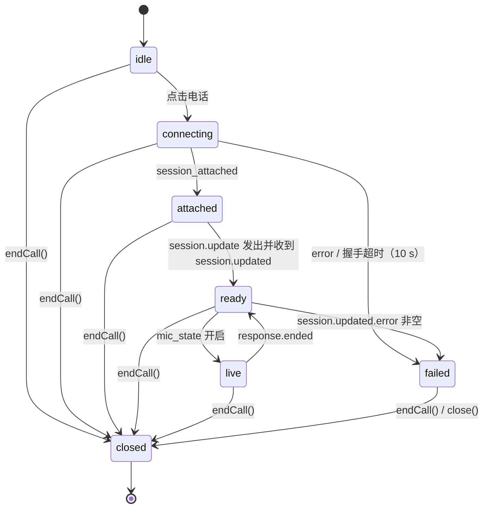
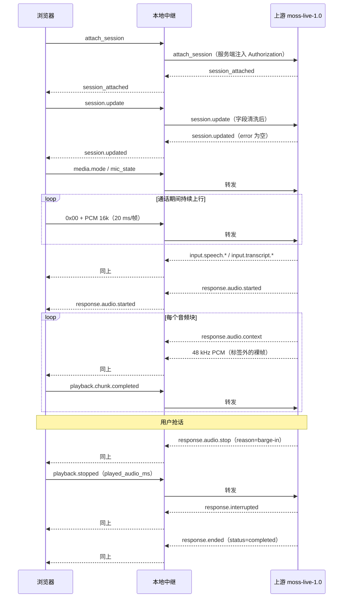

# 开发文档

面向要二次开发、排障或照着复刻的人。阅读前先看 [README](../README.md) 的架构图与
[§7 协议事实](../README.md#7-已确认的上游协议事实)。

---

## 1. 设计目标与取舍

| 目标 | 做法 | 取舍 |
| --- | --- | --- |
| 浏览器零依赖、零构建 | 原生 ES Module + 一份 CSS，不引入 npm/打包 | 无框架生态，靠模块边界保持可读 |
| 密钥不出服务端 | FastAPI 中继注入 `Authorization` | 多一跳本地转发（同机 <1 ms） |
| 协议错误不炸连接 | 服务端白名单 + `session.update` 字段清洗 | 需要与上游字段保持同步 |
| 打断要“立刻停” | 客户端只依赖服务端 `response.audio.stop`，不自行 VAD 停播 | 抢话感知约有 200~400 ms 上游延迟 |
| 可观测 | 通话内事件面板 + `/api/health` 指标 | 前端多了一份事件日志内存（上限 400 条） |

明确不做的事：不做账号体系、不做多租户计费、不缓存对话到服务端（无隐私落盘）。

---

## 2. 运行时结构

```
uvicorn 进程（单 worker）
├── Starlette 路由
│   ├── GET  /                     index.html
│   ├── GET  /static/**            静态资源（no-store）
│   ├── GET  /api/health           健康检查 + 中继指标
│   ├── GET  /api/config           角色/场景/限额（按语言）
│   ├── GET  /api/personas         同上，精简版
│   └── WS   /ws/realtime          中继入口
└── 每个 WebSocket 连接 → 一个 run_relay() 协程组
    ├── task c2u       浏览器 → 上游（校验后转发）
    ├── task u2c       上游 → 浏览器（原样转发 + 自动补 media.mode）
    └── task watchdog  通话时长上限
```

单 worker 足够：一条通话只占两个协程，没有 CPU 密集计算
（重采样在浏览器 AudioWorklet 里做）。指标存在进程内存，多 worker 会各算各的；
需要横向扩展时把 `RelayStats` 换成 Redis 计数器即可。

---

## 3. 后端模块

### 3.1 `app/config.py`

`pydantic-settings` 读 `.env` + 环境变量。要点：

- `get_settings()` 带 `lru_cache`；改配置后调用 `reload_settings()` 或重启进程。
- `masked_api_key` 只返回 `****后四位`，避免把密钥前缀带到前端。
- `api_key_configured` 供 `/api/health` 与前端状态灯使用。

### 3.2 `app/protocol.py`

三个纯函数，全部有单测覆盖：

| 函数 | 作用 |
| --- | --- |
| `validate_client_event(payload)` | 客户端指令白名单 + 字段校验，返回可直接转发的 dict |
| `sanitize_session(session)` | 只保留 `persona{name,aliases,prompt}` 与 `instructions`，超长报错 |
| `check_binary_frame(data, max)` | 校验 `tagged-v1` 前缀与单帧上限，返回 tag |

`ProtocolError(code, message)` 会被中继转成
`{"action":"error","data":{"local":true,...}}` 回给浏览器，**不转发上游**，
因此用户不会因为一次误操作被断线。

> 为什么要这么严：上游收到任何未知字段会立刻
> `invalid_public_request` + 1008 关闭连接。校验必须发生在转发之前。

### 3.3 `app/personas.py`

`PERSONAS`（Luna / Leo）与 `SCENARIOS`（自由对话 / 同声传译 / 视觉助手 / 实时助理），
中英双语文案。场景的 `instructions` 会拼接在角色指令之前：

```python
instructions = "\n".join([scenario.instructions, persona.instructions])
```

新增角色只需往 `PERSONAS` 追加一项（`id/name/tint/tagline/prompt/instructions`），
前端无需改动。

### 3.4 `app/realtime_proxy.py`

`run_relay(ws, settings, user_id)` 的核心顺序：

```
accept → 配额检查 → 连接上游（带 Authorization）
      → 并发跑 c2u / u2c / watchdog → 任一结束就收尾
      → finally：先减 active_sessions，再关闭上游
```

细节：

- **`finally` 里先做同步清理再做 `await`**。否则任务被取消时 `CancelledError`
  会在第一个 `await` 抛出，导致计数泄漏（这个 bug 由 `test_health_counts_sessions` 守住）。
- **`CancelledError` 必须继续上抛**，不要用 `except BaseException` 吞掉，
  否则 Starlette 的 TestClient/连接任务无法正常结束。
- `u2c` 在收到 `session.updated{error:""}` 后自动补发一次 `media.mode tagged-v1`
  （幂等），保证即使前端漏发，二进制帧也能被解析。
- 单帧上限、单条 JSON 上限、通话时长由 `Settings` 控制，超限回本地错误。
- `stats` 是模块级单例；`reset_stats()` 原地清零（不要重新绑定对象，
  否则 `api.py` 里的引用会指向旧实例）。

### 3.5 `app/api.py` / `app/main.py`

- `/api/config` 按 `lang` 返回已翻译的角色与场景，前端切语言时重新拉取。
- 静态资源加 `Cache-Control: no-store`，避免改前端后浏览器拿旧文件。
- `APP_TEST_ASSETS=1` 时把 `tests/fixtures` 挂到 `/test-assets`，只给自动化测试取音频用。

---

## 4. 前端模块

```
app.js（控制器）
├── i18n.js            文案与 <html lang> 切换
├── session.js         协议 + 播放器编排 + 回执/打断
│   └── player.js      48 kHz 播放队列
├── audio-capture.js   麦克风 → 16 kHz PCM
│   └── worklets/capture-processor.js
└── media.js           摄像头/屏幕 → JPEG
```

### 4.1 状态机



状态常量定义在 `session.js` 的 `SessionState`（`idle / connecting / attached / ready / live / failed / closed`）。

`app.js` 里的通话对象（`state.call`）持有：`session / mic / video / transcript /
timerId / raf / statusKey / muted / camOn / screenOn / focus`。
`endCall()` 会把 `state.call` 先置空再异步释放资源，避免回调重入。

### 4.2 `session.js`

职责：连接、握手、事件分发、音频块配对、回执、打断。

关键实现：

```js
// 1:1 配对：context 事件之后紧跟一个二进制帧
case 'response.audio.context':
  this.pendingInfo = { chunkId, runId, turnId }; break;
_handleBinary(buffer) {
  const info = this.pendingInfo; this.pendingInfo = null;
  this.player.enqueue(buffer, info);
}
```

播放回执：`player` 在 **实际播放结束**（`source.onended`）时回调
`playback.chunk.completed`；`response.audio.done` 只标记“本轮发完”，
两者都满足才发 `playback.completed`。这样服务端能准确知道“用户听到了多少”。

打断：

```js
case 'response.audio.stop': {
  const { playedMs, info } = this.player.stop();
  this._sendJson({ action: 'playback.stopped', run_id, turn_id, played_audio_ms: playedMs });
}
```

### 4.3 音频管线

**上行**

```
getUserMedia(48 kHz, 单声道, echoCancellation/noiseSuppression/autoGainControl)
  → AudioWorklet 'moss-capture'
       · 线性插值重采样 48k → 16k（ratio = sampleRate / 16000，兼容 44.1k）
       · 累积 20 ms = 320 samples → Int16（transferable ArrayBuffer）
  → 主线程 new Uint8Array(1 + n)，首字节 0x00 → ws.send
```

- 说完不说话时仍持续发送（近静音）帧，符合上游“说话结束后继续传静音”的要求。
- `ws.bufferedAmount > 512 KB` 时丢帧计数，避免弱网下内存暴涨。

**下行**

```
ws.onmessage(ArrayBuffer, 48 kHz PCM)
  → player.enqueue：Int16 → Float32 → AudioBuffer(48k) → source.start(startAt)
  → startAt = max(now + 80ms, nextTime)；天然形成抖动缓冲
  → source.onended → playback.chunk.completed
```

- `player.stop()` 返回当前块已播毫秒数，供 `playback.stopped` 使用。
- 排布**严格单调**：新块永远排在已排队音频之后。上游实测以约 8x 实时速度下发
  （7.2 s 回答音频 0.89 s 送完），队列天然领先几秒——这是正常的，AudioContext
  按时钟精确排布不会漂移。为"压缩延迟"把新块回填到当前时刻会导致多块同时出声、
  整段回答被压短（已修复，见 `tests/test_player_queue.py` 的回归用例）。

**本地问候音频（cue）**

模型是「用户先开口」的，不会主动说话，所以接通后的第一句由本地音频承担：

```
READY → prepareGreeting(fetch /static/audio/greeting-<角色>-<语言>.wav)
      → session.playCue(buffer, 0.4s)   // 独立 gain + source，不占用 nextTime
      → input.speech.started / response.audio.started → stopCue(0.12s 淡出)
```

- cue 与下行队列**完全独立**：不推后 `nextTime`，上游音频照常从 `now + 80ms` 排起。
  回归用例 `tests/test_greeting_cue.py` 断言问候不会推迟回答第一块。
- 被打断时对 cue 的 gain 做线性 ramp 到 0 再 `stop()`，不会「啪」一下断掉。
- 用户改过人设名字时跳过问候（预录音频里念的是默认名），改语言则换对应语言版本。

### 4.4 视频管线

```
camera: getUserMedia({video:1280x720})  → <video> → canvas(长边 640)  → JPEG 0.8 → 0x01
screen: getDisplayMedia()               → <video> → canvas(长边 1024) → JPEG 0.8 → 0x02
```

- 1 FPS，`canvas.toBlob` 异步编码，上一帧未完成时跳过，避免堆积。
- 关闭时发 `video.state{source,enabled:false}`；用户点浏览器“停止共享”时
  `track.onended` 会同步状态并发同样的指令。
- 两路同时开启时显示「关注画面」按钮，循环 `auto → camera → screen`。

### 4.5 UI 与可观测

- 光球：`--level` 由麦克风 RMS 与播放分析器取最大值，rAF 平滑后写入 CSS 变量，
  CSS 用 `scale(calc(1 + var(--level) * .085))` 驱动。
- 字幕：`input/output.transcript.updated` 是**全量文本**，赋值而非追加。
- 事件面板：`logDebug(dir, action, data)` 保留最近 400 条；`up/down/sys/err` 四类配色。
- 移动端：≤720 px 顶栏按钮只留图标，品牌标签与状态文字隐藏。

---

## 5. 时序：一次带打断的通话



---

## 6. 事件到 UI 的映射

| 事件 | UI 行为 |
| --- | --- |
| `session_attached` | 保存 `session_id`，立即发 `session.update` |
| `session.updated` | `error` 为空 → `media.mode` + 状态「正在聆听」；否则致命错误 |
| `input.speech.started` | 光球停止“说话态”，状态→正在聆听 |
| `input.speech.stopped` | 状态→思考中 |
| `input.transcript.updated/done` | 用户字幕 + 记录实时更新/定稿 |
| `output.transcript.updated/done` | 助手字幕 + 记录实时更新/定稿，轮次 +1 |
| `response.audio.started` | 状态→正在回答，光球脉冲；记录首字延迟 |
| `response.audio.context` | 记录块上下文，等待配对音频 |
| `response.audio.stop` | 停播 + `playback.stopped` |
| `response.interrupted` | 标记记录“被打断”，toast 提示 |
| `response.ended` | 状态回聆听；`status != completed` 提示 |
| `error` | toast；`local:false` 视为致命并结束通话 |
| `tts_speed_changed` | 仅事件面板展示 |

---

## 7. 扩展指南

**加一个角色**：在 `personas.py` 的 `PERSONAS` 里追加字典，`tint` 取 `warm|cool`。
前端自动渲染，无需改 HTML/JS。

**加一个场景**：往 `SCENARIOS` 追加，`instructions` 写规则型文本（越短越稳），
`icon` 用 `chat|translate|eye|spark`（对应 SVG symbol）。

**接入工具调用**：当前 `moss-live-1.0` 不接受 OpenAI 风格 `tools` 定义，
服务端 `session.updated` 只回显空数组。等上游开放后，在
`session.js` 增加 `tool.call` 事件处理，并把结果回传上游即可（协议未定，勿提前实现）。

**换模型**：`MOSS_MODEL` 改成其它实时模型 ID（目前只有 `moss-live-1.0`）。
非实时模型（TTS / 转写）不兼容本协议。

**改限额**：`MAX_BINARY_FRAME`、`MAX_SESSION_SECONDS`、`MAX_TEXT_MESSAGE` 均为纯配置。
若要按 IP 限流，建议在 Nginx 层做 `limit_req`。

---

## 8. 代码约定

1. 前端只用 ESM，不引入打包器；新增模块记得在 `app.js` 里 import。
2. i18n 的 key 以 `区块.名称` 命名，新增文案必须同时补 `zh` 与 `en`。
3. 所有网络/媒体失败都要 `toast()` 给用户看，并在 `console` 留可判定信息。
4. 服务端任何新指令：先加进 `ALLOWED_CLIENT_ACTIONS`，再写 `validate_client_event`
   分支，最后补一条 pytest。
5. 中继的清理逻辑要写在 `finally` 的第一个 `await` 之前，否则任务被取消时会被跳过。

---

## 9. 已知限制

- 音色固定（上游限制），无法为两个角色配置不同声线。
- 上游不支持中途修改人设；修改需重新建立会话。
- 屏幕共享在 Safari 上不可用（`getDisplayMedia` 支持有限）。
- 无断线重连：上游 `memory_scope` 会话级，重连等于新会话，因此选择“提示 + 结束”。
- 指标在进程内存，不适合多副本聚合。
